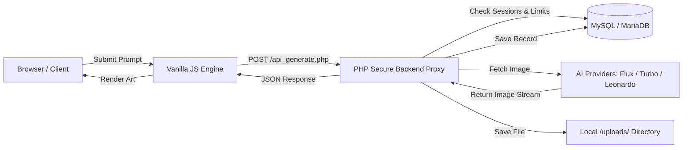

# 🎨 Genova Studio — AI Image Generation Platform

[](https://www.php.net/)
[](https://www.mysql.com/)
[](https://developer.mozilla.org/en-US/docs/Web/JavaScript)
[](LICENSE)
[](#)

> **Genova Studio** is a full-stack, AI-powered image generation studio and creative showcase platform. Built with a responsive frontend and a secure PHP/MySQL backend, it connects modern diffusion models to turn text prompts into high-resolution artwork with instant previews, user history, and quota protection.

---

## 🌟 Key Features

### 🚀 Core Generation Capabilities
- **Multi-Model Support**: Direct integration with top diffusion architectures including **FLUX**, **Turbo**, and **Leonardo AI XL**.
- **Dynamic Dimension & Seed Control**: Configure custom canvas sizes (`512x512`, `768x768`, `1024x1024`) with randomized or deterministic seeds.
- **Fail-Safe Generation**: Features automated fallback mechanisms (including on-the-fly GD placeholder creation) so user experience is never interrupted if external APIs experience downtime.
- **Secure Server-Side Proxy**: API keys and external requests are managed exclusively server-side, preventing client-side credential exposure.

### 🔐 User Management & Security
- **Authentication System**: Secure signup and login flow powered by PHP sessions and `password_hash()` (bcrypt).
- **Rate Limiting**: Built-in per-user quotas to prevent abuse and manage API costs.
- **Personalized Creative Gallery**: Automatically records generation history per user with prompt metadata, model tags, and timestamps.
- **User Profile Drawer**: Real-time user statistics, session management, and single-click logout.

### 🎨 Frontend & Design
- **Modern Dark & Glassmorphism UI**: High-converting creative studio interface inspired by modern digital art marketplaces.
- **Live Canvas & Showcase**: Interactive prompt console, loading progress indicator, and real-time generation previews.
- **Mobile Responsive**: Fully adaptive design that works seamlessly across desktops, tablets, and phones.

---

## 🛠️ Architecture & Tech Stack



| Layer | Technologies |
| :--- | :--- |
| **Frontend** | HTML5, CSS3 (Modern Flex/Grid, Custom Properties), Vanilla JavaScript (ES6+ Modules) |
| **Backend** | PHP 8.1+ (OOP, cURL, GD Image Library) |
| **Database** | MySQL / MariaDB (InnoDB, Foreign Key Constraints, Auto-table creation) |
| **AI Backends** | Pollinations FLUX / Turbo API, Hugging Face Inference API, Leonardo AI |
| **Environment** | XAMPP / Apache Web Server |

---

## 📁 Project Structure

```
genova_studio/
├── api_generate.php          # Secure image generation proxy & rate limiter
├── api_get_generations.php   # History endpoint for user generation records
├── app.js                    # Core application scripts & UI controller
├── auth.js                   # Client-side authentication helpers
├── check_session.php         # Session validation endpoint
├── cloud_ai.php              # Cloud-based model provider integration
├── config.php                # Database connection & auto-table initializers
├── config.js                 # Frontend API configuration
├── config.template.js        # Environment template for frontend keys
├── generator.html            # Main AI generation console
├── generator.css             # Generator interface styling
├── generator.js              # Prompt management & image rendering logic
├── get_user_profile.php      # User statistics & profile endpoint
├── images/                   # UI assets, banners, icons, showcase samples
├── index.html                # Platform landing page & marketplace showcase
├── login.html                # User sign-in interface
├── logout.php                # Session termination handler
├── models.html               # AI models overview & specs
├── process_login.php         # Backend authentication & credential verification
├── process_signup.php        # Backend user registration & password hashing
├── setup_database.php        # Standalone database migration/setup script
├── signup.html               # User registration interface
├── splash.html               # Platform splash screen
├── style.css                 # Global theme & typography styles
├── uploads/                  # Storage directory for generated artworks
└── README.md                 # Project documentation
```

---

## 🚀 Getting Started

### Prerequisites
Make sure you have the following installed on your machine:
* [XAMPP](https://www.apachefriends.org/) (with **Apache** and **MySQL / MariaDB**)
* **PHP 8.0+** (with `curl` and `gd` extensions enabled)
* Web browser (Chrome, Edge, Firefox, or Safari)

---

### Step 1: Clone the Repository
Clone this repository directly into your local web server root (e.g., inside XAMPP's `htdocs`):

```bash
cd C:/xampp/htdocs  # (or D:/xampp/htdocs depending on your setup)
git clone https://github.com/nandanraj740-spec/genova-studio.git
cd genova-studio
```

---

### Step 2: Configure the Database
1. Open the **XAMPP Control Panel** and start **Apache** and **MySQL**.
2. Open [config.php](file:///config.php) to confirm your database port and credentials:
   ```php
   define('DB_SERVER', 'localhost');
   define('DB_USERNAME', 'root');
   define('DB_PASSWORD', '');
   define('DB_PORT', '3306'); // Change to '3307' if your MySQL runs on a custom port
   define('DB_NAME', 'genova_studio');
   ```
3. **Automatic Table Setup**: You do **not** need to manually import SQL files! `config.php` automatically creates the database and all required tables (`users`, `generations`, `rate_limits`) on the very first request.

---

### Step 3: Run the Application
Open your browser and navigate to:
```
http://localhost/genova_studio/
```
Or jump directly into the generator:
```
http://localhost/genova_studio/generator.html
```

---

## 🔒 Security Highlights

- **Password Protection**: Passwords are never stored in plain text; they are encrypted using PHP's standard `PASSWORD_BCRYPT`.
- **Prepared Statements**: All database operations use `mysqli_prepare()` with parameter binding to prevent SQL Injection attacks.
- **CORS & Proxying**: API keys are isolated on the server side — no external tokens are exposed to browser inspectors.
- **Protected Uploads**: User generated files are assigned unique cryptographically random names with `.htaccess` execution blocking.

---

## 🤝 Contributing

Contributions, issues, and feature requests are welcome!
1. Fork the Project
2. Create your Feature Branch (`git checkout -b feature/AmazingFeature`)
3. Commit your Changes (`git commit -m 'feat: add some amazing feature'`)
4. Push to the Branch (`git push origin feature/AmazingFeature`)
5. Open a Pull Request

---

## 📄 License

Distributed under the MIT License. See `LICENSE` for more information.

---

## 👨‍💻 Author

**Nandanraj**
* **GitHub**: [@nandanraj740-spec](https://github.com/nandanraj740-spec)
